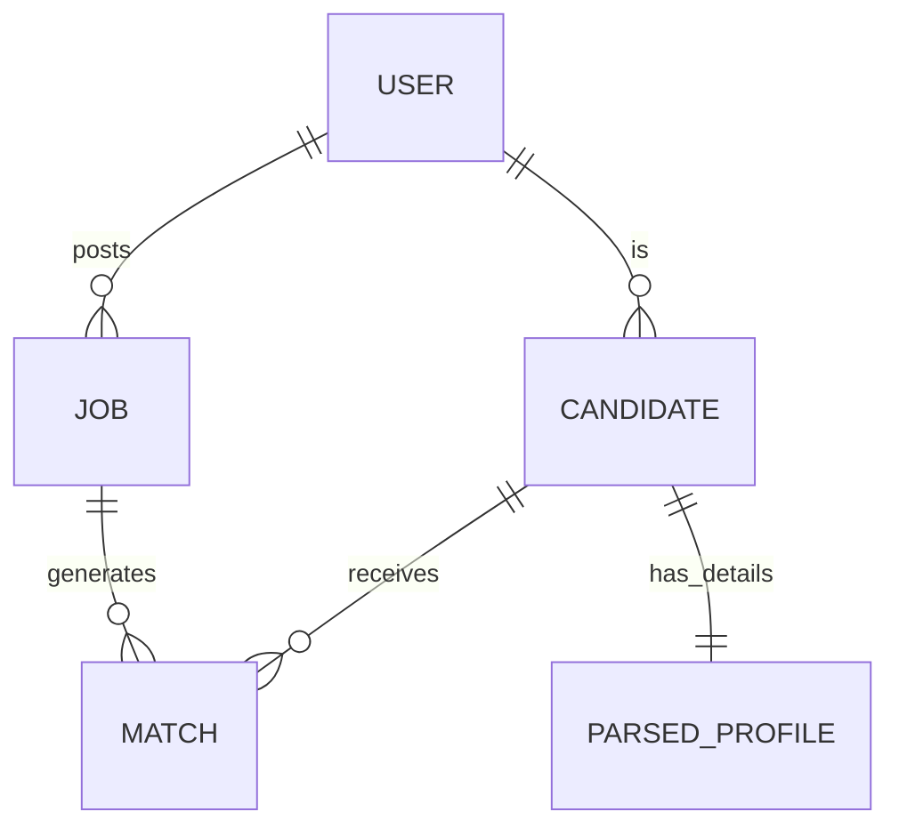

# Database Schema and Data Models

TalentLens employs a polyglot persistence architecture, utilizing PostgreSQL for relational transactional data and structured entities, and MongoDB for unstructured document storage (e.g., raw resume text and complex parsed JSON).

## 1. Relational Schema (PostgreSQL)

The core relational database manages user accounts, job postings, and normalized skills.

### Core Tables
*   **users:** `user_id` (PK), `email`, `hashed_password`, `role`, `created_at`
*   **candidates:** `candidate_id` (PK), `user_id` (FK), `first_name`, `last_name`, `current_title`
*   **jobs:** `job_id` (PK), `employer_id` (FK), `title`, `description_hash`, `status`, `created_at`
*   **matches:** `match_id` (PK), `candidate_id` (FK), `job_id` (FK), `score`, `feedback_status`, `computed_at`

## 2. Document Schema (MongoDB)

Unstructured and deeply nested data is stored in MongoDB collections to allow flexibility as parsing algorithms evolve.

### Collections
*   **raw_resumes:** Stores the original uploaded binary files (via GridFS) and extracted raw text to facilitate re-parsing without requiring user re-upload.
*   **parsed_profiles:** JSON representation of the resume, containing nested arrays for `education`, `work_experience`, `skills`, and `certifications`.
*   **model_inference_logs:** High-volume logs detailing the inputs, feature vectors, and prediction outputs of the matching model, crucial for drift analysis.

## 3. Entity-Relationship Context

## 4. Migration Strategy

Database schema migrations for PostgreSQL are managed via Alembic. All structural changes are scripted, version-controlled, and executed automatically during the CD deployment phase.
