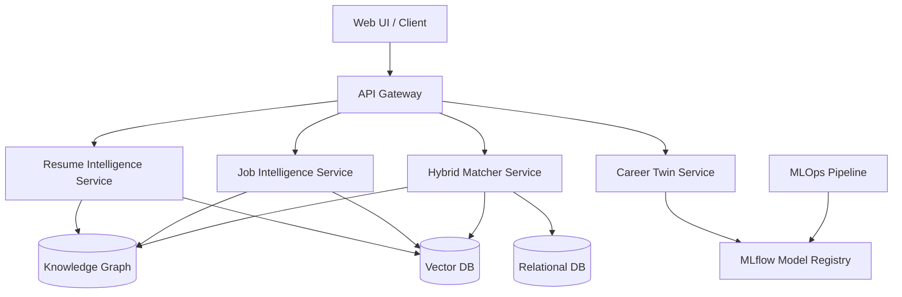
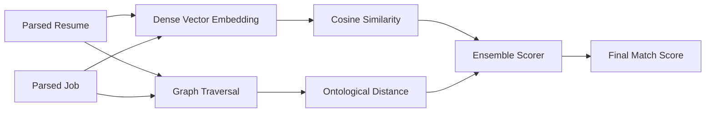
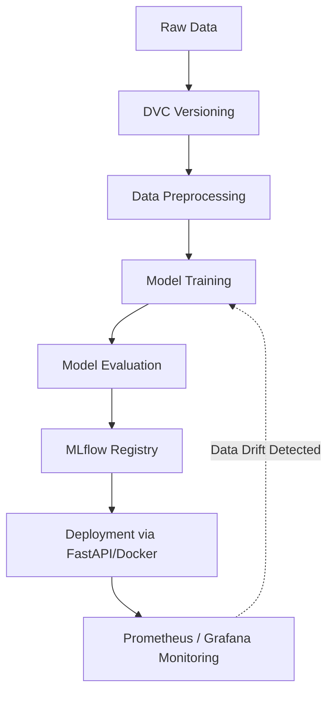

# TalentLens: AI-Powered Talent Intelligence Platform
## Final Project Report

### 1. Abstract
TalentLens is a robust, AI-driven talent intelligence platform designed to bridge the gap between job seekers and employers through precision matching. Utilizing advanced Natural Language Processing (NLP) and machine learning models, the system processes unstructured resume data and job descriptions to generate a unified, structured representation of skills, experience, and domain knowledge. By integrating a Hybrid Matcher, dynamic Skill Graphs, and a personalized Career Twin, TalentLens delivers high-accuracy candidate recommendations while maintaining a scalable, cloud-native architecture governed by rigorous MLOps practices.

### 2. Introduction
The recruitment industry faces significant challenges in unstructured data processing, specifically regarding resumes and job postings. Traditional keyword-matching systems often fail to understand the semantic context of a candidate's skills or a job's requirements. TalentLens addresses these inefficiencies by deploying state-of-the-art transformer models to extract and infer competencies. The objective is to build a scalable, end-to-end Machine Learning pipeline that not only automates candidate screening but also provides actionable career trajectory insights.

### 3. Architecture

The system follows a microservices-based architecture designed for high availability and modular scalability.

#### 3.1 Technology Stack

| Component | Technologies Used |
| :--- | :--- |
| **Frontend** | React, TypeScript, Tailwind CSS |
| **Backend API** | FastAPI, Python, gRPC |
| **Machine Learning** | PyTorch, HuggingFace Transformers, scikit-learn |
| **Databases** | PostgreSQL (Relational), Qdrant/Milvus (Vector), Neo4j (Graph) |
| **MLOps & CI/CD** | MLflow, DVC, GitHub Actions, Docker, Kubernetes |
| **Cloud & Infrastructure**| AWS (EC2, S3), Terraform |

### 4. Modules

| Module | Responsibility |
| :--- | :--- |
| **Resume Intelligence** | Ingests resumes, performs OCR and semantic parsing to extract education, experience, and skills. |
| **Job Intelligence** | Processes job descriptions to identify required/preferred skills and domain terminologies. |
| **Hybrid Matcher** | Calculates compatibility scores between candidates and jobs using dense embeddings and graph traversal. |
| **Career Twin** | Simulates candidate career trajectories and recommends skill acquisitions. |
| **Skill Graph** | Maintains an ontology of skills to map relationships and infer implied competencies. |
| **MLOps** | Governs the ML lifecycle, including experiment tracking, data versioning, and drift detection. |
| **CI/CD** | Automates testing, container building, and deployment processes. |

#### 4.1 Resume Intelligence
The Resume Intelligence module ingests documents (PDF, DOCX) and performs optical character recognition (if required) followed by semantic parsing. It extracts entities such as education, work experience, inferred skills, and proficiency levels using a fine-tuned Named Entity Recognition (NER) model.

#### 4.2 Job Intelligence
Similar to the Resume Intelligence module, this component processes job descriptions to identify mandatory and preferred skills, required experience levels, and domain-specific terminologies, constructing a structured job profile.

#### 4.3 Hybrid Matcher
The Hybrid Matcher calculates the compatibility score between a candidate and a job opening.

#### 4.4 Career Twin
This module acts as a predictive model that simulates a candidate's career trajectory. By analyzing historical progression patterns within the dataset, the Career Twin recommends skill acquisitions and identifies potential future roles, enabling proactive career development.

#### 4.5 Skill Graph
A dynamic ontology implemented in a Graph Database (Neo4j). It maps relationships between adjacent skills (e.g., Python -> Pandas -> Machine Learning) and normalizes aliases, allowing the system to infer that a candidate knowing "PyTorch" is highly likely to possess "Deep Learning" competencies, even if not explicitly stated.

#### 4.6 MLOps
Governs the lifecycle of the machine learning models. We utilize MLflow for experiment tracking, DVC for dataset versioning, and automated drift detection to trigger retraining when the data distribution shifts.

#### 4.7 CI/CD
Continuous Integration pipelines run unit and integration tests upon every commit using GitHub Actions. Continuous Deployment pipelines build Docker images and update Kubernetes deployments in the staging environment, ensuring zero-downtime rollouts.

### 5. Database Architecture
The platform employs a polyglot persistence strategy:
- **Relational Database (PostgreSQL):** Stores user profiles, application statuses, and transactional data.
- **Vector Database (Qdrant):** Stores dense embeddings of resumes and job descriptions for rapid nearest-neighbor search.
- **Graph Database (Neo4j):** Houses the hierarchical Skill Graph and entity relationships.

### 6. User Interface (UI)
The UI is developed as a Single Page Application (SPA) using React. It features real-time feedback mechanisms, interactive skill graphs visualization utilizing D3.js, and comprehensive dashboards for both recruiters (candidate management) and job seekers (career insights).

### 7. Security
- **Authentication:** OAuth2 with JWT (JSON Web Tokens).
- **Data Protection:** At-rest encryption using AES-256 for PII (Personally Identifiable Information) stored in PostgreSQL. In-transit encryption using TLS 1.3.
- **Role-Based Access Control (RBAC):** Strict enforcement of API endpoints ensuring recruiters cannot access other recruiters' proprietary data.

### 8. Testing Strategy
- **Unit Testing:** Pytest for backend Python logic and Jest for React components.
- **Integration Testing:** API contract testing and database interaction testing.
- **Model Evaluation:** Offline evaluation metrics (Precision, Recall, F1-Score, NDCG) before model promotion. A/B testing in production for the Hybrid Matcher's algorithms.

### 9. Unique Features
- **Semantic Skill Inference (Skill Graph):** Unlike standard keyword matchers, TalentLens understands hierarchical skill relationships. It infers implied skills, reducing false negatives in candidate searches.
- **Career Twin Predictive Modeling:** Goes beyond immediate job matching to provide long-term career pathing, acting as an AI mentor based on statistical data of successful career transitions.
- **Multi-Modal Hybrid Matching:** Combines structural, semantic (vector embeddings), and topological (graph distance) heuristics for a highly robust similarity score that resists "keyword stuffing" by candidates.

### 10. References
1. Devlin, J. et al. (2018). *BERT: Pre-training of Deep Bidirectional Transformers for Language Understanding*.
2. Reimers, N., & Gurevych, I. (2019). *Sentence-BERT: Sentence Embeddings using Siamese BERT-Networks*.
3. Neo4j Graph Data Science Documentation.
4. MLflow: A Platform for the Machine Learning Lifecycle.
